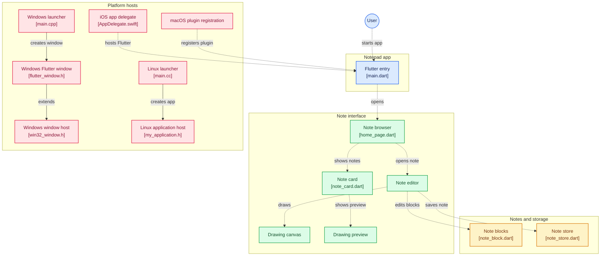

### Notepad
#### Master Piece of Paper (Ryann Kim Sesgundo)

---
### Introduction
> This application was develop to only explore flutter (dart) with the use of cross platform development.
I would like just to see which one is easier to use: `React Native` or `Dart Flutter`.

### Diagram


---

## Developer Documentation

### Overview

Notepad is a cross-platform Flutter note-taking app. A note is an ordered list of
**blocks**, where each block is either typed text or a freehand sketch. Notes can
be organized into folders, searched, and exported/imported as PDF or JSON.
Everything is stored locally on the device; there is no backend or sync service.

- **Package name:** `mpop.notebook`
- **App title:** `Notebook`
- **UI:** Material 3, seeded amber color scheme, cream background (`0xFFFFFBF2`)
- **State management:** plain `StatefulWidget` + `setState` (no state library)
- **Navigation:** imperative `Navigator.push` / `Navigator.pop`

### Tech Stack

| Area | Dependency |
| --- | --- |
| Framework | Flutter (Dart SDK `^3.12.0`) |
| Local storage | `shared_preferences` |
| PDF generation | `pdf` |
| File saving / export | `file_saver` |
| File picking / import | `file_selector` |
| Camera capture | `image_picker` |
| Icons | `cupertino_icons` |
| Linting | `flutter_lints` (`package:flutter_lints/flutter.yaml`) |

### Prerequisites

- Flutter SDK compatible with Dart `^3.12.0`
- A configured target platform (Android, iOS, Linux, macOS, Windows, or web)
- `flutter doctor` should report no blocking issues for the target you build

### Getting Started

```bash
flutter pub get          # install dependencies
flutter run              # run on the default/selected device
flutter run -d linux     # run on a specific platform, e.g. Linux
```

### Available Commands

```bash
flutter analyze          # static analysis + lint checks
flutter test             # run all unit and widget tests
dart format .            # format source
flutter test test/note_block_test.dart   # run a single test file
```

Build commands (per platform):

```bash
flutter build apk        # Android
flutter build ios        # iOS
flutter build linux      # Linux
flutter build macos      # macOS
flutter build windows    # Windows
flutter build web        # Web
```

### Project Structure

```text
lib/
  main.dart                      App entry point and MaterialApp theme
  models/
    note_block.dart              Block model, JSON (de)serialization, legacy support
  screens/
    home_page.dart               Note/folder browser, search, import/export, folder CRUD
    note_editor_page.dart        Mixed text/sketch editor
  services/
    note_store.dart              SharedPreferences persistence for notes and folders
    note_exporter.dart           PDF and JSON export
    note_importer.dart           JSON import and validation
  widgets/
    note_card.dart               Note list row with preview and actions
    drawing_canvas.dart          Freehand drawing surface + StrokePainter
    drawing_thumbnail.dart       Scaled sketch preview painter

test/
  note_block_test.dart           Block serialization and legacy fallback
  note_exporter_test.dart        PDF/JSON export output
  note_importer_test.dart        JSON import round-trip and validation
  widget_test.dart               End-to-end create-note widget tests
```

Platform runners live in `android/`, `ios/`, `linux/`, `macos/`, `windows/`, and
`web/`. They are standard Flutter-generated hosts and generally do not need
changes when working on app features.

### Architecture

The app follows a small layered structure:

1. **Entry** — `main.dart` builds `MaterialApp` and mounts `NotepadHomepage`.
2. **Screens** — own UI state and orchestrate services. `NotepadHomepage` manages
   the notes/folders lists; `NoteEditorPage` manages an editable block list.
3. **Widgets** — reusable presentation and drawing components (`NoteCard`,
   `DrawingCanvas`, `DrawingThumbnailPainter`).
4. **Services** — `NoteStore` (persistence), `NoteExporter` (file output), and
   `NoteImporter` (file input). They are plain classes instantiated where used.
5. **Model** — `NoteBlockData` plus encode/decode helpers. This is the single
   source of truth for how note content is serialized.

Data flows in one direction: a screen reads/writes services, and persistence
happens after each mutation. The editor returns a complete note map to the home
page via `Navigator.pop`, and the home page inserts or replaces it in its list.

### Data Model

A **note** is a `Map<String, String>` with these keys:

| Key | Purpose |
| --- | --- |
| `title` | Note title (may be empty) |
| `content` | Plain text of all text blocks joined by `\n\n`; used for search, preview, and legacy compatibility |
| `blocks` | JSON-encoded `List<NoteBlockData>` (the authoritative content) |
| `folder` | Folder name, or `''` for unfiled notes |

`content` is **derived** from text blocks whenever a note is saved. Drawings are
never represented in `content`.

#### Block JSON

Text block:

```json
{ "type": "text", "text": "Hello world" }
```

Drawing block:

```json
{
  "type": "drawing",
  "strokes": [[[12.0, 40.5], [18.2, 44.1]], [[100.0, 20.0]]],
  "backgroundImage": "<base64-encoded image>"
}
```

- `strokes` is a list of strokes; each stroke is a list of `[dx, dy]` points in
  canvas-local logical pixels.
- `backgroundImage` is optional and base64-encoded. It is omitted when empty.

#### Legacy Compatibility

`decodeBlocks` first tries the `blocks` key. If it is missing or malformed, it
falls back to the older format using `content` (text) and `drawing` (encoded
strokes). This keeps notes saved by earlier versions loadable.

#### Storage Layout

`NoteStore` persists two keys via `SharedPreferences`:

| Key | Type | Content |
| --- | --- | --- |
| `notes` | `String` | JSON array of note maps |
| `folders` | `List<String>` | Folder names |

Notes are saved as a whole list on every change (`saveNotes`). On web,
`shared_preferences` is backed by browser local storage.

### Services

#### `NoteStore` (`lib/services/note_store.dart`)

- `loadNotes()` / `saveNotes()` — read and write the JSON note array.
- `loadFolders()` / `saveFolders()` — read and write folder names.
- Malformed note JSON is treated as an empty list rather than throwing.

#### `NoteExporter` (`lib/services/note_exporter.dart`)

- `exportNote(note, format)` — builds bytes and saves them, returning the saved
  path (or `null` when the user cancels).
- `buildPdf(note)` — renders title, export timestamp, text blocks, and sketches
  into an A4 `MultiPage` document. Strokes are scaled to fit a 220pt-high box.
- `buildJson(note)` — writes `{ title, exportedAt, blocks }` as pretty-printed
  JSON.
- File names are sanitized (`[\\/:*?"<>|]` and control chars replaced with `_`),
  defaulting to `Untitled note` and truncated to 60 characters.
- Saving behavior:
  - **Save dialog:** Android, iOS, macOS, Windows (`FileSaver.saveAs`).
  - **Direct save:** web and Linux (`FileSaver.saveFile`, e.g. Downloads).

#### `NoteImporter` (`lib/services/note_importer.dart`)

- `pickAndImport()` — opens a JSON file picker and parses the selection.
- `parse(raw)` — validates JSON shape, converts blocks via
  `NoteBlockData.fromJson`, and returns an app note map with `title`, `content`,
  and `blocks`. Throws `FormatException` with a user-facing message on invalid
  input.
- Imported folders are preserved by the home page; if the folder does not exist,
  it is created automatically.

### UI and Interaction Flow

#### Home (`NotepadHomepage`)

- On startup, loads notes and folders and shows a progress indicator until done.
- **Home view:** folders first, then unfiled notes. Folders show their note count.
- **Folder view:** selecting a folder filters notes to that folder; the back arrow
  clears the selection.
- **Search:** filters both folder names and notes by title/content
  (case-insensitive). Search resets when entering a folder.
- **Folder actions:** create, rename (keeps notes in sync), delete (moves notes to
  unfiled). Names are trimmed, non-empty, and unique case-insensitively.
- **Note actions:** open editor, delete with confirmation, export as PDF/JSON.
- **Import:** top app bar action; reads a JSON export and prepends it.
- **New note:** floating action button opens the editor with the current folder
  preselected.

#### Editor (`NoteEditorPage`)

- Holds a title, a folder dropdown, and an ordered list of editor blocks.
- Text blocks use `TextEditingController`; sketch blocks use a
  `GlobalKey<DrawingCanvasState>` so the parent can read live strokes/background.
- **Add text** and **Add sketch** append blocks and scroll to the end.
- Removing an empty block is immediate; removing a non-empty block asks for
  confirmation.
- **Save** requires a title or at least one non-empty block. Empty text blocks
  are dropped, as are empty sketches without a background.
- **Cancel** exits immediately for empty notes; otherwise it asks for
  confirmation.
- **Export** works from the editor and exports the current unsaved state.
- Returning from the editor pops a note map, which the home page inserts/replaces
  and persists.

#### Drawing Canvas (`DrawingCanvas`)

- Freehand pointer input with a single active pointer (`Listener` events).
- Uses an `EagerGestureRecognizer` so drawing does not scroll the editor.
- Tools: four pen colors, background image picker/removal, camera capture
  (Android/iOS/web), undo, and clear.
- Exposes `allStrokes` (including the in-progress stroke) and `backgroundImage`
  for the parent editor to collect.
- `StrokePainter` renders live strokes; `DrawingThumbnailPainter` renders scaled
  previews in the note list.

### Testing

Tests use `flutter_test` and import the app as `package:notebook/...`.

- `note_block_test.dart` — round-trips mixed blocks and verifies legacy fallback.
- `note_exporter_test.dart` — checks the PDF header and JSON structure.
- `note_importer_test.dart` — verifies export → import round-trip and rejects
  invalid files.
- `widget_test.dart` — drives the full create-note flow and asserts persisted
  block types. `SharedPreferences.setMockInitialValues({})` is used in `setUp`
  so storage is isolated per test.

When adding behavior, prefer unit tests for serialization/services and widget
tests for user-visible flows. Run `flutter test` and `flutter analyze` before
submitting changes.

### Platform Notes

- **SharedPreferences** stores all data locally; on web it maps to
  `localStorage`. There is no encryption.
- **image_picker** opens the native camera on Android/iOS and a capture input on
  the web. Camera capture is not available on desktop, where the menu shows a
  notice instead. iOS requires `NSCameraUsageDescription` (already set).
- **file_selector** is used for JSON import and sketch background images. Some
  platforms may require plugin registration (handled by Flutter tooling).
- **file_saver** uses a native save dialog on Android, iOS, macOS, and Windows;
  on web/Linux it saves directly (typically to Downloads).
- **Large backgrounds:** background images are embedded as base64 inside the
  note JSON, so large images increase storage size and load time.
- Desktop/web builds are supported by the generated runners; test the export
  dialogs on each target because save behavior differs.

### Extending the App

**Add a new block type**

1. Extend `NoteBlockType` and `NoteBlockData` in `lib/models/note_block.dart`
   (constructors, `toJson`, `fromJson`).
2. Update `_EditorBlock`, `_collectBlocks`, and `_buildBlock` in
   `lib/screens/note_editor_page.dart`.
3. Update `NoteCard` preview logic and, if needed, add a preview widget.
4. Update `NoteExporter.buildPdf` and `buildJson` to render/emit the new block.
5. Add serialization and export tests.

**Add an export format**

1. Add a value to `NoteExportFormat`.
2. Add a case in `NoteExporter.exportNote` and a `build<Format>` method.
3. Add menu entries wherever exports are offered (`NoteCard` and the editor app
   bar).
4. Add a test for the produced bytes.

**Replace local storage**

Implement the same `loadNotes`/`saveNotes`/`loadFolders`/`saveFolders` surface as
`NoteStore` and swap the instance in `NotepadHomepage`. The rest of the app only
depends on the note map shape, not on `SharedPreferences` directly.

### Known Limitations and Gotchas

- Every save rewrites the entire notes list; this is fine for typical note counts
  but not optimized for very large datasets.
- `content` duplicates text from `blocks`. Keep it in sync when constructing
  notes outside the editor/importer.
- Drawings store points in the canvas's local coordinate space. Changing the
  canvas size changes how existing sketches scale (thumbnail/PDF fitting handles
  this for display).
- There is no undo/redo across blocks, no cloud sync, and no note-level backup
  besides JSON export.
- Background images are decoded on every rebuild; avoid very large images.

### Code Conventions

- Use `const` constructors and widgets where possible.
- Keep services UI-free and instantiate them at the call site.
- Persist immediately after mutating notes/folders.
- Preserve the legacy decode path when changing the serialized format.
- Follow `flutter_lints`; run `flutter analyze` and `dart format .` before
  committing.
