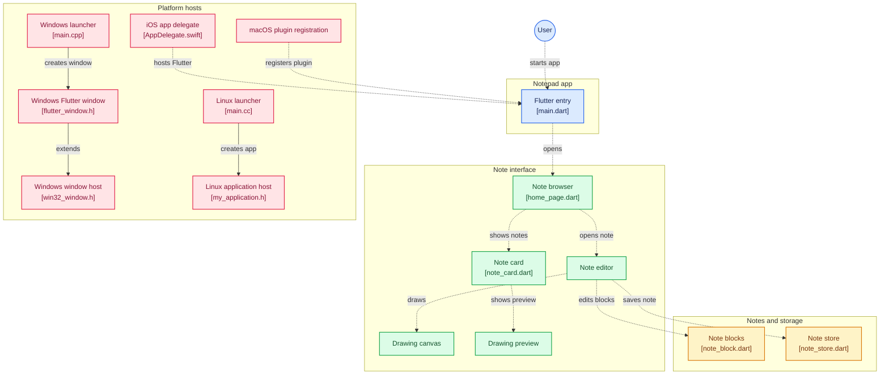

### Notepad
#### Master Piece of Paper (Ryann Kim Sesgundo)

---
### Introduction
> This application was develop to only explore flutter (dart) with the use of cross platform development.
I would like just to see which one is easier to use: `React Native` or `Dart Flutter`.

### Diagram

